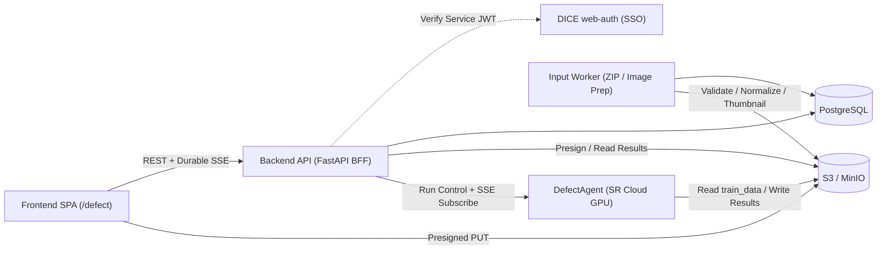

[한국어](./README.md) | **English**

# Defect Studio Backend (`defect-studio-backend-service`)

Backend API server (BFF) and asynchronous input-preparation worker for **Defect Studio**, the manufacturing defect dataset synthesis service. Sitting between the Frontend SPA (`/defect`), central authentication (`web-auth`), Object Storage (S3/MinIO), and the remote GPU synthesis engine (`DefectAgent`), it handles **SSO verification, conversation/run persistence, durable SSE relaying, and large-scale training input normalization**.

## System Topology



## Quick Start

- **Prerequisites**: Docker & Docker Compose (Python 3.12+ and `uv` when running tests or scripts on the host)

```bash
# 1. Create .env once and fill in your local DB password and authorized staging keys
cp .env.example .env

# 2. Start PostgreSQL → Alembic migrations → API (:18089) + Input Worker
docker compose up -d
docker compose ps -a
```

- **API & OpenAPI Spec**: `http://127.0.0.1:18089/docs` (auto-generated Swagger/ReDoc is the single source of truth for request/response schemas)
- **Health Check**: `http://127.0.0.1:18089/api/health`
- **Run Tests (Host)**: `uv run pytest`

## Repository Layout

Modules are organized by DDD Bounded Context, each following Clean Architecture layers (`domain` · `application` · `infrastructure` · `presentation`).

```text
defect-studio-backend-service/
├── src/
│   ├── auth/                  # DICE SSO service-token verification and account provisioning/linking
│   ├── thread/                # Conversation threads and message history
│   ├── run/                   # Remote Agent run control, durable SSE ingestion/replay, and step logs
│   ├── train_data/            # Native S3 upload reservation, batch sealing, and mask/thumbnail state
│   ├── data_integration/      # Async ZIP extraction, pixel validation, and normalization worker (input_worker)
│   ├── plan/                  # Defect synthesis plans (DefectPlan)
│   ├── result/                # Generated artifact indexing and resolution-matched bundle ZIP downloads
│   ├── common/                # Shared domain primitives, exceptions, blocking_io executor, storage adapters
│   └── container/             # FastAPI app factory (app.py), settings, DB engine, and DI wiring
├── alembic/                   # Database schema migrations
├── scripts/                   # Operational utilities (e.g., S3 bucket CORS setup)
├── backfill_results.py        # Idempotent re-indexer for missed generated artifacts
└── docs/                      # Architectural rationale and operational guides (ko / en)
```

## Documentation (`docs/`)

Documentation records only **architectural intent, cross-system invariants, and operational/rollout constraints** that cannot be read directly from source code or OpenAPI schemas.

| Guide | Topics Covered |
| --- | --- |
| [Architecture & Core Invariants](./docs/en/architecture.md) | Why API and Worker are separated, DDD layer rules, `blocking_io` event-loop isolation, S3 prefix isolation, upload/run mutual exclusion, and durable SSE relay boundaries |
| [Development & Operational Constraints](./docs/en/development.md) | Local Compose workflow, corporate CA & `NO_PROXY` rules, shared S3 CORS, Alembic schema policy, rollout ordering, and diagnostic tools |

