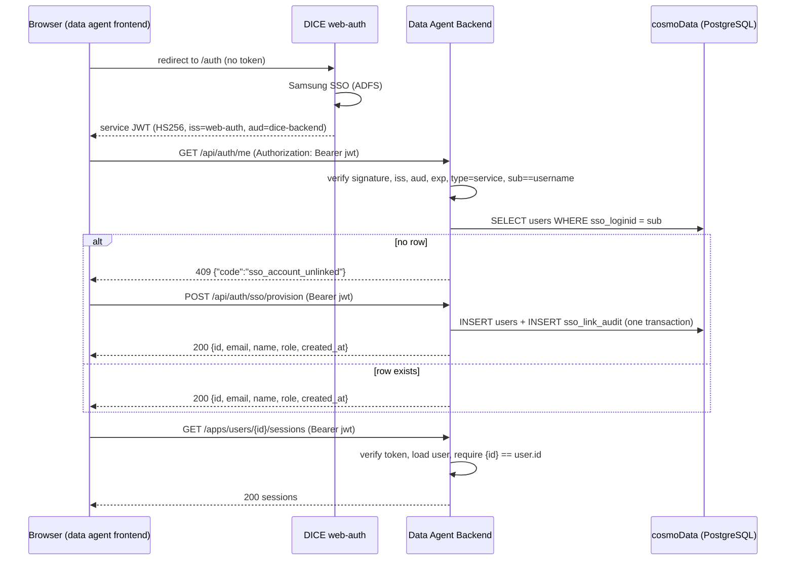

# Data Agent SSO authorization: implementation plan

**Status:** plan agreed on 2026-11-17, not yet implemented
**Supersedes:** [authentication.md](authentication.md), the backend-as-OIDC-client design, which is no longer pursued
**Reference implementation:** `defect_agent/` at the repository root, a partial copy of the Defect Studio backend's `src/auth` module and its deployment notes
**Audience:** data agent maintainers, the data agent frontend team, and the DICE platform and Defect Studio teams who will be asked for files and credentials

## 1. Summary

The data agent will authenticate users exactly the way the Defect Studio backend ("defect agent") does:

- Samsung SSO is performed by the DICE platform's central `web-auth` service, never by this backend.
- After login the browser holds a short-lived **service JWT** issued by `web-auth`. The frontend sends it as `Authorization: Bearer <token>` on every call.
- This backend verifies the token offline with the shared `SERVICE_JWT_SECRET` (HS256), maps the Samsung login ID to a row in its own `users` table, and refuses any session request that is unauthenticated or targets another user's id.
- First-time users are provisioned automatically through `POST /api/auth/sso/provision`.

**Identical to the defect agent:** token verification rules, endpoint paths and contracts, status codes and error codes, the `users` and `sso_link_audit` data model, and the user-visible login experience.

**Adapted to this repository:** the async `PostgreSQLClient` with raw SQL instead of a sync ORM, tables created at startup instead of alembic, `config.yaml` plus environment variables instead of pydantic-settings, and the `routers` / `services` / `infra` layout instead of hexagonal layering.

**Left out:** the defect agent's email and password endpoints (`/register`, `/login`, `/refresh`, `/sso/link`). They exist only to migrate accounts created before SSO. The data agent has no such accounts.

### 1.1 Decisions recorded

| Topic | Decision |
|---|---|
| Identity provider integration | DICE `web-auth` service JWT, same as the defect agent |
| Code structure | Repository conventions, same behavior |
| `user_id` in `/apps/users/{user_id}/...` | The local UUID returned by `GET /api/auth/me` |
| Password endpoints | Not implemented |
| Existing chat sessions | Created without authentication; they will no longer be visible after cutover. Accepted |
| `GET /health` | Stays public |
| `GET /logs` | Proposed: requires an authenticated user. Confirm, or choose admin-only |

## 2. Authorization flow

### 2.1 User-visible flow

1. The user opens the data agent frontend. It has no token, so it redirects the browser to the DICE auth URL: `/auth` on the gtrai host, or the absolute staging or production URL when the frontend is hosted elsewhere.
2. `web-auth` performs Samsung SSO against ADFS and returns the browser to the frontend with a service JWT.
3. The frontend calls `GET /api/auth/me` with the token.
   - `200`: the user exists. The frontend keeps the returned `id` and loads the session list.
   - `409 sso_account_unlinked`: first visit. The frontend calls `POST /api/auth/sso/provision` with the same token, then `/me` again.
   - `401`: the token is invalid or expired. The frontend redirects to `/auth` again.
4. Every `/apps/users/{id}/...` call carries the token. The backend verifies it, resolves the user, and checks that `{id}` is that user's UUID.



### 2.2 Per-request decision table

| Condition | Response |
|---|---|
| No `Authorization` header, scheme is not `Bearer`, bad signature, wrong `iss` or `aud`, expired, missing `exp` or `sub`, `type != service`, malformed `sub`, `sub != username` | `401 {"code":"invalid_token","detail":"..."}` with `WWW-Authenticate: Bearer` |
| `SERVICE_JWT_SECRET` not configured | `401 {"code":"invalid_token","detail":"SSO is unavailable"}`. The service also refuses to start, see section 5 |
| Valid token, no `users` row with that `sso_loginid` | `409 {"code":"sso_account_unlinked"}` |
| Valid token, linked user, path `user_id` is not that user's UUID | `403 {"code":"forbidden"}` |
| Provision: login ID unknown, email already belongs to another user | `409 {"code":"sso_account_conflict"}` |
| Provision: token has no usable email | `409 {"code":"sso_account_conflict"}` |
| Provision: login ID already linked | `200` with the existing user (idempotent) |
| Valid token, linked, path matches | The handler runs. The `user_id` passed to `AgentRunner` is the verified UUID |

### 2.3 Token verification rules

Copied from `defect_agent/src/auth/infrastructure/service_token_verifier.py` and kept line for line:

1. `jwt.decode(token, SERVICE_JWT_SECRET, algorithms=["HS256"], issuer="web-auth", audience="dice-backend", options={"require_exp": True, "require_sub": True})`. Any `JWTError` means invalid token.
2. `claims["type"] == "service"`.
3. `sub` and `username` must be strings. `loginid = sub.strip().casefold()`.
4. `loginid` is rejected if empty, longer than 255 characters, containing whitespace or control characters, or equal to `undefined`, `null`, or `none`.
5. `username.strip().casefold() == loginid`.
6. `full_name` becomes `name`: stripped, truncated to 100 characters, `None` if blank or not a string.
7. `email` is normalized with `email_validator.validate_email(..., check_deliverability=False).normalized.casefold()`, `None` if missing or invalid.
8. Result: a frozen `SsoIdentity(loginid, email, name)`.

Issuer, audience, and algorithm are constants, as in the defect agent.

## 3. Endpoints

| Method and path | Auth | Behavior |
|---|---|---|
| `GET /api/auth/me` | service JWT, linked | Returns `{id, email, name, role, created_at}` |
| `POST /api/auth/sso/provision` | service JWT | Creates the user with role `user` if neither login ID nor email is taken. Returns the same shape as `/me`. Repeating returns the same user |
| `/apps/users/{user_id}/...` (all 8 routes in `routers/agent.py`) | service JWT, linked, `{user_id}` must equal `user.id` | Otherwise unchanged |
| `GET /health` | none | Unchanged, needed by probes |
| `GET /logs` | service JWT, linked (proposed) | Server logs must not stay public |

The `/api/auth` prefix matches the defect agent so the frontend's auth client code can be reused as-is. The existing routes keep their paths.

## 4. Data model

Both tables are created at startup through `PostgreSQLClient`, following the `session_run_locks` pattern in `infra/session_lock.py`, in the existing `cosmoData` database.

```sql
CREATE TABLE IF NOT EXISTS users (
    id          UUID PRIMARY KEY,
    email       VARCHAR(255) NOT NULL UNIQUE,
    sso_loginid VARCHAR(255) UNIQUE,
    name        VARCHAR(100),
    role        VARCHAR(20)  NOT NULL DEFAULT 'user',
    created_at  TIMESTAMPTZ  NOT NULL DEFAULT now()
);

CREATE TABLE IF NOT EXISTS sso_link_audit (
    id           BIGSERIAL PRIMARY KEY,
    user_id      UUID NOT NULL REFERENCES users(id),
    sso_loginid  VARCHAR(255) NOT NULL,
    actor_type   VARCHAR(20)  NOT NULL,   -- 'provision' | 'self' | 'admin'
    actor        VARCHAR(255) NOT NULL,
    evidence_ref VARCHAR(255),
    created_at   TIMESTAMPTZ  NOT NULL DEFAULT now()
);
```

The only difference from the defect agent's `users` table is the missing `password_hash` column, since there is no password login. The unique constraints that make provisioning race-safe are the same. Email lookups compare `lower(email)`, as the defect agent does.

Provisioning runs `INSERT INTO users` and `INSERT INTO sso_link_audit` in one transaction. On a unique violation the code re-selects by `sso_loginid`: if a concurrent request already created the user it is returned, otherwise `sso_account_conflict`. `PostgreSQLClient` gains a `transaction()` context manager for this; today each call opens its own transaction.

Chat sessions in ADK's `sessions` table are keyed by the UUID from this point on. Rows created before authentication keep their old arbitrary `user_id` and are no longer listed for anyone.

## 5. Configuration

New block in `config.yaml` and a new entry in `_ENV_MAP` in `common/config.py`:

```yaml
auth:
  service_jwt_secret: ""   # supply via SERVICE_JWT_SECRET; never commit the real value
```

| Environment variable | Config key | Notes |
|---|---|---|
| `SERVICE_JWT_SECRET` | `auth.service_jwt_secret` | Same name as the defect agent and its Helm secret key `service-jwt-secret`. Must equal the value `web-auth` signs with |

Constants in `common/constants.py`: `SERVICE_JWT_ISSUER = "web-auth"`, `SERVICE_JWT_AUDIENCE = "dice-backend"`, `SERVICE_JWT_ALGORITHM = "HS256"`.

Startup validation, as in the defect agent: the service refuses to start when the secret is empty or a known placeholder. The exact placeholder list is copied from the defect agent's `settings.py` once that file is available. There is no local `SECRET_KEY` here, so the defect agent's "secret reused" check does not apply.

CORS needs no change for Bearer tokens. The `Authorization` header is already permitted by `allow_headers=["*"]`. Narrowing `allow_origins` remains roadmap issue #7.

`config.yaml` is tracked in git and already contains live credentials. The JWT secret must only ever be passed through the environment (Docker `-e`, Kubernetes secret), never written into that file.

## 6. New dependencies

| Package | Purpose |
|---|---|
| `python-jose[cryptography]` | JWT decoding, the same library as the defect agent |
| `email-validator` | Email normalization, the same as the defect agent. Also enables pydantic `EmailStr` |

Pin to the versions in the defect agent's `requirements.txt` (not yet copied, see section 9). Add to both `requirements_py313_prod.txt` and `requirements_py313_dev.txt`.

## 7. File inventory

| File | Status | Purpose |
|---|---|---|
| `common/constants.py` | changed | Issuer, audience, algorithm, `AuthErrorCode` enum, default role |
| `common/config.py` | changed | `AuthConfig`, `Settings.auth`, `SERVICE_JWT_SECRET` env mapping, startup validation |
| `data_agent/auth/__init__.py` | new | Exports |
| `data_agent/auth/models.py` | new | `SsoIdentity`, `User` |
| `data_agent/auth/exceptions.py` | new | `InvalidToken`, `SsoAccountUnlinked`, `SsoAccountConflict`, `Forbidden` |
| `data_agent/auth/service_token_verifier.py` | new | Section 2.3, line for line |
| `data_agent/auth/dependencies.py` | new | `get_sso_identity`, `get_current_user`, `require_path_user` and their `Annotated` aliases |
| `data_agent/infra/user_repository.py` | new | `initialize()`, `find_by_id`, `find_by_email`, `find_by_sso_loginid`, `provision_sso_user` |
| `data_agent/infra/postgresql_client.py` | changed | `transaction()` context manager |
| `data_agent/services/sso_account_service.py` | new | `provision(identity)` with the defect agent's conflict rules |
| `data_agent/schemas/auth.py` | new | `UserResponse`, `AuthErrorResponse` |
| `data_agent/routers/auth.py` | new | `/api/auth/me`, `/api/auth/sso/provision` |
| `data_agent/routers/__init__.py` | changed | Register the auth router |
| `data_agent/routers/agent.py` | changed | `user: PathUserDep` on all 8 handlers |
| `data_agent/routers/logs.py` | changed | Require an authenticated user |
| `data_agent/app.py` | changed | Create and initialize `UserRepository`, expose it on `app.state`, register the auth exception handlers |
| `config.yaml` | changed | `auth:` block with an empty placeholder |
| `Dockerfile`, `run_data_agent_backend.sh` | changed | Document and pass `SERVICE_JWT_SECRET` |
| `requirements_py313_prod.txt`, `requirements_py313_dev.txt` | changed | Section 6 |
| `README.md` | changed | Login flow, configuration, local testing |
| `docs/authentication.md` | changed | Marked superseded |
| `tests/auth/test_service_token_verifier.py` | new | Every rule in section 2.3, with tokens minted by a test secret |
| `tests/auth/test_dependencies.py` | new | 401, 409, and 403 paths |
| `tests/infra/test_user_repository.py` | new | SQL and race handling with a mocked client |
| `tests/services/test_sso_account_service.py` | new | Provisioning rules |
| `tests/routers/test_auth.py` | new | `/me` and `/provision` |
| `tests/routers/test_agent.py` | changed | Unauthenticated and cross-user cases |
| `tests/test_app.py` | changed | Lifespan wiring. Also fixes references to names that no longer exist in the code |

Nothing in `services/agent_runner.py`, `infra/artifact_store.py`, or the agents changes.

## 8. Implementation order

Each step is one commit pair (`feat:` plus `test:`) following the roadmap conventions.

1. **Configuration and dependencies.** `AuthConfig`, env mapping, startup validation, constants, packages.
2. **Token verifier.** Pure code, no database. Tests mint tokens with a test secret and cover every rule in section 2.3.
3. **User storage and provisioning.** Tables, repository, `transaction()`, `SsoAccountService`.
4. **Auth router and error handling.** `/me`, `/provision`, exception handlers producing `{"code", "detail"}`.
5. **Guard the session and log routes.** `PathUserDep` on `routers/agent.py`, auth on `/logs`, updated router tests, `test_app.py` fixes.
6. **Operations and docs.** Dockerfile, run script, README, and this document's status line.

Steps 1 to 5 are verified entirely by the unit test suite. Step 5 is the one that changes behavior for the frontend and should land only once the frontend handles the flow in section 2.1.

## 9. What is needed from other people

Section 12 says where each item lives, who holds it, and how to obtain it.

### 9.1 Files from the Defect Studio backend repository

Copy them into `defect_agent/`, keeping the original paths.

| File | Why |
|---|---|
| `src/common/presentation/middleware/auth.py` | The bearer guard (`get_current_user`, `get_local_current_user`, `get_sso_identity`). Needed to match header parsing and error ordering exactly. **Most important** |
| `src/container/settings.py` | Secret validation rules and the placeholder list |
| The module that converts `DomainException` subclasses into HTTP responses (probably `src/container/app.py` or something under `src/common/presentation/`) | The exact JSON body of 401 and 409 responses |
| `requirements.txt` | Versions of `python-jose` and `email-validator` |
| The alembic migration that adds `users.sso_loginid` and `sso_link_audit` | Confirms column types and constraints |

Without these files the plan is still implementable from the documented behavior in `SSO_ROLLOUT_107.md` and the controller. The risk is small differences in error bodies.

### 9.2 From the Defect Studio frontend repository

For the data agent frontend team: the auth client code. It shows how the frontend detects a missing token, redirects to `/auth`, receives the service JWT back from `web-auth`, keeps it in memory, handles `401` and `409 sso_account_unlinked`, and renews an expiring token. The data agent frontend must do the same.

### 9.3 Credentials and values from the DICE platform team

| Item | Needed for | Notes |
|---|---|---|
| `SERVICE_JWT_SECRET` of **staging** `web-auth` | Everything | The same value the defect agent's staging backend reads from the `defect-studio-stage-secrets` secret, key `service-jwt-secret`. Highly sensitive: anyone holding it can forge a token for any user |
| `SERVICE_JWT_SECRET` of **production** `web-auth` | Production deployment | Later |
| Confirmation of token claims | Section 2.3 | `iss=web-auth`, `aud=dice-backend`, `type=service`, `sub` and `username`, `email`, `full_name`, `exp`, and the token lifetime |
| How the frontend receives the token | Frontend | A redirect parameter, or a `/auth/token` call backed by a `web-auth` session cookie |
| Allowlist entry in `web-auth` | Browser login from a host other than gtrai | The data agent frontend URL(s), for example `http://xxx.xxx.xxx.xxx:zzz/`. The defect agent needed the same step: "Central auth must allow the DefectAgent callback URL" |
| Gateway route for production | Production | `/auth` to `dice-platform-web-auth.dice.svc.cluster.local:3020` on the data agent host or path, like the defect agent's `virtualService.authPath` |
| A test account | Testing | Your own login ID, allowed in the staging development login mode |

Known URLs from the defect agent deployment: staging auth `https://stage.gtrai.sec.samsung.net/auth`, production auth `https://dice.gtrai.sec.samsung.net/auth`.

No ADFS registration is required. `web-auth` already holds the relying-party trust. That was the largest external dependency in the superseded design, and it disappears here.

### 9.4 Already available in this repository

The `postgresql_db` settings. The database user already creates `session_run_locks` at startup, so it can create the two new tables.

## 10. Testing, including on a standalone server (IP:port)

Token verification is offline. The backend never calls `web-auth`; it only needs the shared secret. The backend therefore behaves the same whether the data agent runs behind the gtrai gateway or at `http://xxx.xxx.xxx.xxx:yyy`. What differs is only how the browser obtains a token.

| Tier | What it tests | Needs |
|---|---|---|
| 1. Unit tests | Everything in this document, with tokens minted by a test secret | nothing |
| 2. Backend on any host with a real token | Real staging `web-auth` tokens against the data agent backend | the staging `SERVICE_JWT_SECRET` |
| 3. Full browser login | The frontend redirect and token hand-off | frontend work (9.2) and the `web-auth` allowlist entry (9.3) |

### 10.1 Tier 2: testing the backend without a frontend

Option A: mint a token yourself with the staging secret, using the same claims `web-auth` uses.

```python
from datetime import datetime, timedelta, timezone
from jose import jwt

claims = {
    "iss": "web-auth", "aud": "dice-backend", "type": "service",
    "sub": "your.loginid", "username": "your.loginid",
    "email": "your.loginid@samsung.com", "full_name": "Your Name",
    "exp": datetime.now(timezone.utc) + timedelta(minutes=30),
}
print(jwt.encode(claims, SERVICE_JWT_SECRET, algorithm="HS256"))
```

Option B: use a real token. Log in to the **staging** defect agent with your own account, open the browser developer tools, and copy the `Authorization` header from any API request. The same `web-auth` issued it and the data agent verifies it with the same secret, so it is accepted until it expires.

Then exercise the backend:

```bash
curl -s -H "Authorization: Bearer $TOKEN" http://xxx.xxx.xxx.xxx:yyy/api/auth/me
# first call: 409 sso_account_unlinked
curl -s -X POST -H "Authorization: Bearer $TOKEN" http://xxx.xxx.xxx.xxx:yyy/api/auth/sso/provision
curl -s -H "Authorization: Bearer $TOKEN" http://xxx.xxx.xxx.xxx:yyy/api/auth/me
# 200; note the "id" value
curl -s -H "Authorization: Bearer $TOKEN" http://xxx.xxx.xxx.xxx:yyy/apps/users/<id>/sessions
curl -s http://xxx.xxx.xxx.xxx:yyy/apps/users/<id>/sessions
# 401 without a token
curl -s -H "Authorization: Bearer $TOKEN" http://xxx.xxx.xxx.xxx:yyy/apps/users/someone-else/sessions
# 403 for another user's id
```

Never paste a token into logs, issues, chat, or external websites.

### 10.2 Tier 3: browser login on IP:port

The defect agent team already runs this setup locally: frontend on `localhost:13007`, backend on `127.0.0.1:18089`, login through the real staging auth server (see `defect_agent/LOCAL_DEVELOPMENT.md`). The same works for the data agent on a server, with two conditions:

- The data agent frontend redirects to the absolute URL `https://stage.gtrai.sec.samsung.net/auth`, because `/auth` on the IP host goes nowhere, and handles the token hand-off the way the defect frontend does.
- The DICE team adds the frontend's URL to the `web-auth` allowlist, as they did for the defect agent and for localhost development.

Plain HTTP works for Bearer tokens, since no `Secure` cookie is involved, but the token then travels unencrypted on the internal network. That is acceptable for testing and not for production.

## 11. Security notes

- The secret is symmetric and shared with `web-auth` and every other DICE backend. Anyone who can read it can forge any user. Keep it in a secret store or the environment only.
- Tokens are never logged. Auth failures are logged with cause, path, and login ID where known.
- `401` responses carry `WWW-Authenticate: Bearer`.
- Roles come only from the local `users.role` column, never from token claims. New users are `user`. `admin` is set by an operator in the database, as in the defect agent.

## 12. Where to find each piece

Section 9 lists what is needed. This section says where each item is and who holds it. Names come from `defect_agent/ARGOCD_DEPLOYMENT.md`, the two GitHub workflows, and `defect_agent/LOCAL_DEVELOPMENT.md`.

### 12.1 Source code and deployment definitions

| Piece | Where it is | How to get it |
|---|---|---|
| Missing backend files (9.1) | Defect Studio backend repository `github.sec.samsung.net/GT8-AutomationVision/defect-studio-backend-service`. Paths: `src/common/presentation/middleware/auth.py`, `src/container/settings.py`, the module that maps `sso_account_unlinked` to HTTP (probably `src/container/app.py`), `requirements.txt`, `alembic/versions/` | Clone or browse the repository. Without repository access, the backend image contains the full source, see 12.4 |
| Frontend auth client (9.2) | Defect Studio frontend repository `github.sec.samsung.net/GT8-AutomationVision/defect-studio-train-service` | Search it for `VITE_AUTH_BASE_URL`, `sso/provision`, and `sso_account_unlinked` |
| How `SERVICE_JWT_SECRET` reaches the container, and the `/auth` VirtualService | GitOps repository `github.sec.samsung.net/GT8-AutomationVision/argocd-application-repository`, chart `charts/defect-studio`, values `environments/stage/defect-studio.yaml` and `environments/production/defect-studio.yaml` | Browse. The values files name the secret and its keys but do not contain the value. The data agent's own deployment will eventually be declared here too |
| web-auth behavior: claims, token lifetime, how the frontend receives the token, the callback allowlist | The DICE platform repository, the one containing `platform/backend/app/core/web_auth.py` that the superseded `authentication.md` cites, and the DICE platform team | Ask the platform team, or decode a real token yourself, see 12.5 |

### 12.2 Secrets and accounts

| Piece | Where it is | Who can hand it over |
|---|---|---|
| Staging `SERVICE_JWT_SECRET` | Kubernetes secret `defect-studio-stage-secrets`, key `service-jwt-secret`, namespace `dice-stage`. The same value sits in web-auth's own secret in that namespace and in every Defect Studio developer's local `.env` | Anyone with `kubectl` read access to `dice-stage` (command in 12.3). Otherwise the DICE platform team, who own web-auth, or the Defect Studio team |
| Production `SERVICE_JWT_SECRET` | Secret `defect-studio-prod-secrets`, key `service-jwt-secret`, namespace `dice` | DICE platform team. Needed only at production rollout |
| web-auth allowlist entry for the data agent frontend URL | web-auth configuration in `dice-stage`, platform-owned | DICE platform team |
| Gateway route `/auth` on the data agent host | Istio VirtualService declared in the GitOps repository | DICE platform team, together with the data agent's deployment |
| Test account in the staging development login mode | web-auth configuration | DICE platform team: ask them to allow your login ID, as was done for the Defect Studio developers |

Receive secrets through the company's approved secret channel. Never through chat, email, an issue, or a commit.

### 12.3 Argo CD: what it shows and what it hides

Argo CD confirms every name and wiring but masks secret values. In the Argo CD UI, open Applications and then `defect-stage`:

- Resource tree, Deployment `defect-studio-backend`, Live Manifest: the `env` list shows `SERVICE_JWT_SECRET` with `valueFrom.secretKeyRef` pointing at secret `defect-studio-stage-secrets`, key `service-jwt-secret`. This confirms the secret name and key.
- Resource tree, Secret `defect-studio-stage-secrets`, Live Manifest: every `data` value is displayed as `++++++++`. Argo CD redacts Secret contents in both the UI and the API, and this cannot be switched off per user.
- Parameters tab: `backend.secret.name`, `backend.secret.keys.serviceJwtSecret`, `virtualService.authService`, `virtualService.authPath`. This is what `ARGOCD_DEPLOYMENT.md` already captured.
- The web-auth service belongs to a different, platform-owned Application and may not be visible to you at all.

Reading the value therefore needs `kubectl` access to the namespace:

```bash
kubectl -n dice-stage get secret defect-studio-stage-secrets -o jsonpath="{.data.service-jwt-secret}" | base64 -d
```

Without `kubectl`, ask the DICE platform team or the Defect Studio team.

### 12.4 Extracting the missing source files from the backend image

The backend Dockerfile copies the whole repository into `/app`, so the deployed image contains every file listed in 9.1. The tag currently deployed is in `ARGOCD_DEPLOYMENT.md`; newer tags appear in the GitOps values file. Registry login uses the Artifactory account the CI calls `DOCKER_USERNAME`.

```bash
IMAGE=dice-docker-local.bart.sec.samsung.net/defect-studio-backend:2026.11.13-fbfab42
docker login dice-docker-local.bart.sec.samsung.net
docker pull $IMAGE
docker run --rm --entrypoint ls $IMAGE /app/src/common/presentation/middleware /app/src/container /app/alembic/versions
docker run --rm --entrypoint cat $IMAGE /app/src/common/presentation/middleware/auth.py
docker run --rm --entrypoint cat $IMAGE /app/src/container/settings.py
docker run --rm --entrypoint cat $IMAGE /app/src/container/app.py
docker run --rm --entrypoint cat $IMAGE /app/requirements.txt
```

Copy the files into `defect_agent/` under their original paths. The image is internal; do not push the extracted files anywhere outside the company.

### 12.5 Confirming the token claims yourself

Log in to the staging defect agent with your own account, open the browser developer tools, and copy the `Authorization` header value from any API request. Decode the payload locally:

```bash
python -c "import base64,json,sys; p=sys.argv[1].split('.')[1]; print(json.dumps(json.loads(base64.urlsafe_b64decode(p+'='*(-len(p)%4))), indent=2))" "$TOKEN"
```

This prints `iss`, `aud`, `type`, `sub`, `username`, `email`, `full_name`, `iat`, and `exp`, which also gives the token lifetime. It does not verify the signature and does not need the secret. Do this on your own machine only, never on jwt.io or any other website.
